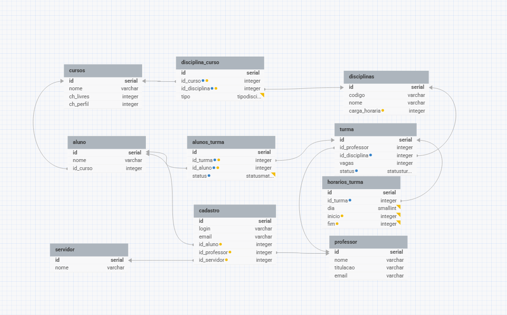

# Sistema de Matrícula de Graduação

Monorepo do sistema de matrícula de graduação:

- **Back-end** ([`API/`](API/README.md)): Express + TypeScript + Prisma + PostgreSQL 16. Centraliza validação, regras curriculares e controle transacional de vagas.
- **Front-end** ([`front-end/`](front-end/README.md)): Next.js + React + Tailwind CSS. Consome a API, redireciona para o login quando a sessão expira (`401`/`403`) e exibe as mensagens de erro do back-end em toasts.

> [!IMPORTANT]
> **Ambiente de demonstração:** o login é feito **apenas pelo nome de usuário, sem senha**. A tela de login lista as contas criadas pelo seed para que o avaliador teste todos os perfis com um clique. Não é um fluxo de autenticação para produção.

**Índice**

- [Início rápido](#início-rápido) · [Contas de demonstração](#contas-de-demonstração-seed)
- [Glossário](#glossário)
- [O que foi implementado](#o-que-foi-implementado) · [Requisito extra](#requisito-extra-choque-de-horário-e-grade-semanal)
- [Arquitetura do back-end](#arquitetura-do-back-end) · [Convenções](#convenções)
- [Regras de negócio](#regras-de-negócio-e-onde-são-garantidas)
- [Front-end](#front-end) · [Banco de dados](#banco-de-dados) · [Testes](#testes)
- [Decisões e trade-offs](#decisões-principais-e-trade-offs) · [Limitações](#limitações-conhecidas-e-próximos-passos)

---

## Início rápido

**Pré-requisitos:** Docker + Docker Compose, Node.js 20+ e npm.

Não há scripts na raiz do repositório; cada pasta tem seus próprios comandos. Todos os passos abaixo partem da **raiz do repositório**:

```bash
# 1. Subir o PostgreSQL 16
docker compose up -d

# 2. Configurar as variáveis do back-end
cp API/.env.example API/.env

# 3. Instalar dependências, aplicar migrations (gera o Prisma Client) e popular o banco
cd API
npm install
npm run db:migrate
npm run db:seed

# 4. Iniciar a API em modo desenvolvimento (ainda em API/)
npm run dev
```

Em **outro terminal**, também a partir da raiz:

```bash
# 5. Instalar e iniciar o front-end
cd front-end
npm install
npm run dev
```

Para rodar os testes do back-end (com o PostgreSQL do passo 1 no ar):

```bash
cd API
npm test
```

**URLs após subir:**

| Serviço                                       | URL                                     |
| :-------------------------------------------- | :-------------------------------------- |
| Front-end                                     | http://localhost:3000                   |
| API                                           | http://localhost:5000                   |
| Swagger UI (principal referência das rotas)   | http://localhost:5000/docs              |
| Especificação OpenAPI (JSON)                  | http://localhost:5000/docs/openapi.json |

### Contas de demonstração (seed)

| Login          | Perfil      | Curso / Titulação        | O que ilustra                                                                                         |
| :------------- | :---------- | :----------------------- | :---------------------------------------------------------------------------------------------------- |
| `secretaria`   | `servidor`  | Secretaria Acadêmica     | CRUD de disciplinas, professores, alunos e turmas/vagas                                               |
| `ricardo.prof` | `professor` | Doutor                   | Funcionalidade extra: painel e grade do professor                                                     |
| `ana.cc`       | `aluno`     | Ciência da Computação    | Aprovações nos 3 grupos, excedente de perfil contado como livre, aprovada em `IF672`, ocupa a única vaga de `IF674` (turma lotada) |
| `bruno.cc`     | `aluno`     | Ciência da Computação    | Reprovado em `IF673` (pode cursar de novo) e cursando `IF676` (choca com `EC703`, adjacente a `AD801`) |
| `carla.ec`     | `aluno`     | Engenharia da Computação | `IF668` é perfil e `IF670` é obrigatória em EC, o inverso de CC (mesma disciplina, grupo diferente por curso) |
| `diego.ec`     | `aluno`     | Engenharia da Computação | Reprovado em `EC702`, com turma aberta disponível para nova matrícula                                 |

> [!NOTE]
> O perfil `servidor` representa um servidor técnico-administrativo da **Secretaria Acadêmica**. O nome segue a tabela `servidor` do modelo de dados e aparece nas rotas do front-end (`/dashboard/servidor/...`).

---

## Glossário

- **Grupos de carga horária:** cada disciplina, **para um curso específico**, pertence a um de três grupos:
  - **Obrigatória:** vínculo `obrigatoria` em `disciplina_curso`.
  - **Perfil** (eletiva de perfil): vínculo `perfil` em `disciplina_curso`.
  - **Livre** (eletiva livre): disciplina **sem** vínculo com o curso.
- **Classificação relativa ao curso:** a mesma disciplina pode ser obrigatória para um curso e de perfil (ou livre) para outro.
- **Transbordo de perfil:** a carga horária de perfil aprovada que passa do exigido pelo curso é contabilizada como eletiva livre.
- **Integralizada × em curso:** só disciplinas `aprovado` contam como integralizadas; as `cursando` aparecem à parte no campo `emCurso` da resposta de progresso.
- **Regras 1 a 13:** as regras de negócio do enunciado, detalhadas na [tabela de regras](#regras-de-negócio-e-onde-são-garantidas).

---

## O que foi implementado

- [x] **Login por usuário e proteção por perfil:** [`login.service.ts`](API/src/domains/login/login.service.ts), [`auth.middleware.ts`](API/src/middlewares/auth.middleware.ts), [`AuthContext.tsx`](front-end/contexts/AuthContext.tsx) e [`ProfileGuard.tsx`](front-end/components/auth/ProfileGuard.tsx).
- [x] **Cadastros da Secretaria ([Regras 1 a 5](#regras-de-negócio-e-onde-são-garantidas)):** disciplinas, professores e turmas com busca e paginação, em [`disciplinas.service.ts`](API/src/domains/disciplinas/disciplinas.service.ts), [`professores.service.ts`](API/src/domains/professores/professores.service.ts) e [`turmas.service.ts`](API/src/domains/turmas/turmas.service.ts).
- [x] **Fluxo do Aluno ([Regras 6 a 13](#regras-de-negócio-e-onde-são-garantidas)):** ofertas com classificação relativa ao curso, matrícula com lock, cancelamento lógico, grade semanal e progresso, em [`ofertas.service.ts`](API/src/domains/ofertas/ofertas.service.ts), [`matriculas.service.ts`](API/src/domains/matriculas/matriculas.service.ts) e [`progresso.service.ts`](API/src/domains/progresso/progresso.service.ts).
- [x] **Funcionalidades extras (fora do enunciado):**
  - Pré-cadastro e desligamento de alunos e professores pela Secretaria ([`alunos.service.ts`](API/src/domains/alunos/alunos.service.ts), [`professores.service.ts`](API/src/domains/professores/professores.service.ts)).
  - Auto-cadastro de conta para quem já foi pré-cadastrado (`POST /auth/register`, [`RegisterView.tsx`](front-end/components/auth/RegisterView.tsx)).
  - Painel e grade de horários do professor ([`HorariosProfessorView.tsx`](front-end/components/professor/HorariosProfessorView.tsx)).

---

## Requisito extra: choque de horário e grade semanal

- **O que é:** bloqueio, no back-end, de matrículas com horários conflitantes; sinalização prévia nas ofertas (campo `conflitaComHorario` da resposta de `GET /ofertas`); e grade semanal visual (`GET /matriculas/grade` + [`HorariosView.tsx`](front-end/components/aluno/HorariosView.tsx)).
- **Por que foi escolhido:** o choque de horário protege a integridade da matrícula, assim como o limite de vagas, e se encaixa no modelo de ofertas com uma única tabela nova, `horarios_turma` (dia da semana e intervalo em minutos). A grade semanal complementa a regra, mostrando ao aluno os horários já ocupados antes e depois de se matricular.
- **Regras definidas:**
  1. Cada horário tem um `dia` (`1` = segunda … `7` = domingo) e um intervalo `[inicio, fim)` em minutos desde 00:00 (`inicio` em `0..1439`, `fim` em `1..1440`, com `fim > inicio`), garantido por `CHECK` no banco e pelo schema Zod.
  2. Dois intervalos só chocam se forem no mesmo dia e `a.inicio < b.fim && b.inicio < a.fim`. Horários adjacentes (ex.: `14:00–16:00` e `16:00–18:00`) **não** conflitam ([`horario.utils.ts`](API/src/utils/horario.utils.ts)).
  3. Ao criar uma turma, o schema rejeita horários que se sobrepõem entre si ([`turmas.schema.ts`](API/src/domains/turmas/turmas.schema.ts)).
  4. Turmas sem horário cadastrado nunca conflitam e aparecem separadas na grade, no campo `semHorario`.
  5. `POST /matriculas` verifica o conflito dentro da transação com lock e retorna `422` com código `CONFLITO_DE_HORARIO`, citando a disciplina conflitante.

---

## Arquitetura do back-end

A organização de [`API/src/`](API/src) é **inspirada em DDD**, sem adotar o DDD tático completo.

- **Adotado:**
  - Um módulo por contexto em `src/domains/<contexto>/`, separado por responsabilidade (`*.routes.ts`, `*.controller.ts`, `*.service.ts`, `*.repository.ts`, `*.schema.ts`).
  - Funções puras de domínio, isoladas de I/O ([`progresso.domain.ts`](API/src/domains/progresso/progresso.domain.ts), [`matriculas.domain.ts`](API/src/domains/matriculas/matriculas.domain.ts)).
  - Utilitários puros (ex.: `horario.utils.ts`).
- **Deixado de fora de propósito:** agregados, entidades ricas com estado, eventos de domínio e containers/factories de injeção de dependência. Pelo escopo reduzido do sistema, as camadas apenas importam e chamam funções umas das outras, evitando boilerplate.

```text
API/src/
├── app.ts / server.ts          # Express, CORS, Swagger (/docs) e registro das rotas
├── docs/swagger.ts             # Especificação OpenAPI 3.0.3
├── domains/<contexto>/         # routes, controller, service, repository, schema (+ domain)
├── lib/prisma.ts               # Instância única do PrismaClient
├── middlewares/                # auth, cors e tratamento global de erros
└── utils/                      # erros tipados, error-mapper, horário, JWT, paginação, perfil, validação (Zod)
```

**Caminho de uma requisição:**

1. `routes` → `authMiddleware` / `authorize(...perfis)` (autenticação e perfil).
2. `controller` valida a entrada com `parseSchema` (Zod).
3. `service` aplica as regras e monta os DTOs.
4. `repository` acessa o banco via Prisma (com `SELECT ... FOR UPDATE` nas operações de vaga).

Qualquer erro lançado em uma dessas etapas é convertido em resposta HTTP pelo `errorHandlerMiddleware`.

---

## Convenções

- **Contrato de erro:** todas as falhas respondem `{ message, code, details? }`, montado por [`error-handler.middleware.ts`](API/src/middlewares/error-handler.middleware.ts) e [`error-mapper.utils.ts`](API/src/utils/error-mapper.utils.ts).
- **Status HTTP:**

  | Status | Quando                                                                                             |
  | :----- | :------------------------------------------------------------------------------------------------- |
  | `400`  | Validação de entrada, parâmetros inválidos ou referência inexistente (`P2003`)                     |
  | `401`  | Token ausente, inválido ou expirado; também no login com usuário inexistente (não há senha, então o login inexistente é a "credencial inválida") |
  | `403`  | Perfil sem permissão para a rota                                                                   |
  | `404`  | Recurso inexistente; também ao acessar matrícula de outro aluno, para não revelar que ela existe   |
  | `409`  | Violação de unicidade (`P2002`)                                                                    |
  | `422`  | Violação de regra de negócio ou de `CHECK` constraint                                              |
  | `503`  | Banco de dados indisponível                                                                        |

- **Paginação e busca:** `page` (padrão `1`), `pageSize` (`1..50`, padrão `10`) e `search` (case-insensitive), via [`pagination.utils.ts`](API/src/utils/pagination.utils.ts).
- **JWT:** tokens HS256 assinados com `node:crypto`, sem biblioteca externa ([`jwt.utils.ts`](API/src/utils/jwt.utils.ts)). Segredo e expiração vêm de `JWT_SECRET` e `JWT_EXPIRES_IN`.
- **Concorrência:** as operações que mexem em vagas (`POST /matriculas` e `PATCH /turmas/:id/vagas`) rodam em `prisma.$transaction` e travam a linha da turma com `SELECT ... FROM turma WHERE id = $1 FOR UPDATE`.
- **Documentação das rotas:** o **Swagger UI** em `/docs` (e o JSON em `/docs/openapi.json`) é a referência para endpoints, payloads e códigos de erro.

---

## Regras de negócio e onde são garantidas

Testes: **C** = [`constraints.test.ts`](API/prisma/constraints.test.ts) · **Cad** = [`cadastros.regras.test.ts`](API/tests/cadastros.regras.test.ts) · **Mat** = [`matriculas.regras.test.ts`](API/tests/matriculas.regras.test.ts) · **Prog** = [`progresso.regras.test.ts`](API/tests/progresso.regras.test.ts).

| Regra                                                   | Onde é garantida                                                                                         | Testes   |
| :------------------------------------------------------ | :------------------------------------------------------------------------------------------------------- | :------- |
| **1.** Código da disciplina é único                     | Banco (`UNIQUE`) + [`disciplinas.repository.ts`](API/src/domains/disciplinas/disciplinas.repository.ts) (`P2002` → `409`) | C · Cad  |
| **2.** CH múltipla de 15, entre 15 e 120                | Banco (`CHECK`) + [`disciplinas.schema.ts`](API/src/domains/disciplinas/disciplinas.schema.ts) (Zod)    | C · Cad  |
| **3.** E-mail do professor é único                      | Banco (`UNIQUE`) + [`professores.repository.ts`](API/src/domains/professores/professores.repository.ts) (`P2002` → `409`) | C · Cad  |
| **4.** Turma exige disciplina, professor e ≥ 1 vaga     | Banco (`FK`/`CHECK`) + [`turmas.schema.ts`](API/src/domains/turmas/turmas.schema.ts) + [`turmas.repository.ts`](API/src/domains/turmas/turmas.repository.ts) | C · Cad  |
| **5.** Vagas não podem ficar abaixo dos matriculados    | `turmas.repository.ts`, com lock `FOR UPDATE` → `422`                                                    | Cad      |
| **6.** Não matricular em turma lotada                   | [`matriculas.repository.ts`](API/src/domains/matriculas/matriculas.repository.ts), com lock `FOR UPDATE` → `422` | Mat      |
| **7.** Bloquear disciplina já aprovada; liberar reprovada | `matriculas.repository.ts` (histórico em `alunos_turma`) → `422`                                       | Mat      |
| **8.** Cancelamento devolve a vaga                      | [`matriculas.service.ts`](API/src/domains/matriculas/matriculas.service.ts) + repository (`status = 'cancelada'`) | Mat      |
| **9.** Aluno só vê e altera as próprias matrículas      | JWT (`idPerfil`) + `matriculas.service.ts` (`404` para matrícula alheia)                                 | Mat      |
| **10.** Classificação relativa ao curso                 | [`progresso.domain.ts`](API/src/domains/progresso/progresso.domain.ts) (`classificarDisciplina`)        | Prog     |
| **11.** Excedente de perfil conta como livre            | `progresso.domain.ts` (`calcularProgresso`)                                                              | Prog     |
| **12.** Só aprovada integraliza; cursando vai em `emCurso` | [`progresso.service.ts`](API/src/domains/progresso/progresso.service.ts) + `progresso.domain.ts`      | Prog     |
| **13.** Percentual ≤ 100% e falta ≥ 0                   | `progresso.domain.ts` (`montarGrupoProgresso`)                                                           | Prog     |
| **Extra.** Choque de horário e grade                    | Banco (`CHECK` nos horários) + Zod + [`horario.utils.ts`](API/src/utils/horario.utils.ts) + [`matriculas.domain.ts`](API/src/domains/matriculas/matriculas.domain.ts) + repository | C · Mat  |

---

## Front-end

Desenvolvido em **Next.js 16 (App Router) + React 19 + Tailwind CSS 4**. Comandos em [`front-end/README.md`](front-end/README.md).

### Cliente HTTP ([`api.engine.ts`](front-end/engines/api.engine.ts))

- Instância única do `axios`, configurada com `NEXT_PUBLIC_API_URL` (padrão `http://localhost:5000`) e timeout de 15 s.
- Interceptor que injeta `Authorization: Bearer <token>`.
- Normaliza qualquer falha para `ApiClientError` (`status`, `code`, `details`).
- Handlers globais de sessão para `401`/`403`, registrados pelo [`AuthContext.tsx`](front-end/contexts/AuthContext.tsx) via `registrarHandlersSessao`.
- Duas variantes de chamada: `comToast` (exibe toast de sucesso/erro automaticamente) e `semToast`.

```ts
// Trecho de front-end/services/auth.service.ts
return apiEngine.comToast.post<RespostaLogin>("/auth/login", body, {
  toast: toast ?? {
    success: true,
    fallbackSuccess: "Sessão iniciada com sucesso.",
    error: true,
  },
});
```

### Notificações ([`toast.engine.ts`](front-end/engines/toast.engine.ts) + [`ToastProvider.tsx`](front-end/components/ui/ToastProvider.tsx))

- `toast.engine.ts` é um barramento de eventos (`ADD`, `DISMISS`, `CLEAR`) independente do React; o `ToastProvider` assina esse barramento e renderiza os toasts.
- Tipos `success`, `error`, `warning` e `info`; região `aria-live="polite"`; fechamento manual ou automático após 4,5 s.
- Permite exibir a mensagem de regra de negócio vinda do back-end:

```ts
// Trecho de front-end/components/aluno/OfertasView.tsx
const mensagem =
  erro instanceof ApiClientError
    ? erro.message
    : "Não foi possível realizar a matrícula nesta turma.";
toastEngine.error(mensagem);
```

### Telas

| Área                 | Rotas                                                                                      |
| :------------------- | :----------------------------------------------------------------------------------------- |
| Entrada              | `/login`, `/cadastro`                                                                      |
| Aluno                | `/dashboard/aluno`, `/ofertas`, `/matriculas`, `/horarios`, `/progresso`                   |
| Secretaria           | `/dashboard/servidor`, `/disciplinas`, `/professores`, `/alunos`, `/turmas`                |
| Professor            | `/dashboard/professor`, `/horarios`                                                        |

### Estados de lista, URL e responsividade

- [`ListStatePanel.tsx`](front-end/components/ui/ListStatePanel.tsx) padroniza carregamento, lista vazia, busca sem resultado e erro com botão de tentar novamente.
- [`useUrlListQuery.ts`](front-end/hooks/useUrlListQuery.ts) sincroniza `?search=` e `?page=` na URL.
- `HorariosView.tsx` mostra a grade como tabela semanal a partir de 640 px e, abaixo disso, como abas por dia (seg a sáb).

---

## Banco de dados



O SQL inicial, usado como ponto de partida, está em [`docs/db/db_referencia.sql`](docs/db/db_referencia.sql). A **fonte da verdade** do esquema é [`API/prisma/schema.prisma`](API/prisma/schema.prisma) junto com a migration [`API/prisma/migrations/20260101000000_init/migration.sql`](API/prisma/migrations/20260101000000_init/migration.sql).

**Da referência para o Prisma/migration final:**

- A estrutura relacional e os nomes de tabelas e colunas em `snake_case` foram preservados com `@map`/`@@map`; no Prisma Client as propriedades ficam em camelCase.
- Os índices `UNIQUE` viraram `CREATE UNIQUE INDEX` gerados pelo Prisma.
- As `CHECK` constraints (`disciplinas_ch_valida`, `cadastro_um_perfil`, `turma.vagas >= 1`, `horarios_turma_intervalo`, entre outras) e os `COMMENT`s foram escritos à mão na `migration.sql`, porque o `schema.prisma` não os declara.

**Seed ([`API/prisma/seed.ts`](API/prisma/seed.ts)):**

- 2 cursos: Ciência da Computação e Engenharia da Computação.
- 15 disciplinas: compartilhadas entre os cursos, exclusivas de um curso e livres.
- 1 servidor e 3 professores (2 sem conta, para testar o auto-cadastro).
- 4 alunos com histórico `aprovado`/`reprovado`.
- 10 turmas encerradas e 8 abertas, incluindo uma turma lotada e pares de horários com choque e adjacência.

Mais detalhes em [`API/README.md`](API/README.md).

---

## Testes

Execute em `API/` com `npm test` (`vitest run`, com `fileParallelism: false`). Um banco de testes dedicado é criado e migrado automaticamente por [`test-db.global.ts`](API/tests/setup/test-db.global.ts); o PostgreSQL precisa estar no ar.

| Arquivo                                                          | O que valida                                                                                 |
| :--------------------------------------------------------------- | :------------------------------------------------------------------------------------------- |
| [`constraints.test.ts`](API/prisma/constraints.test.ts)          | `UNIQUE` e `CHECK` constraints diretamente no PostgreSQL                                     |
| [`cadastros.regras.test.ts`](API/tests/cadastros.regras.test.ts) | Controle de perfil da Secretaria e Regras 1 a 5, via HTTP (`supertest`)                      |
| [`matriculas.regras.test.ts`](API/tests/matriculas.regras.test.ts) | Regras 6 a 9, isolamento entre alunos e choque/adjacência de horários                      |
| [`progresso.regras.test.ts`](API/tests/progresso.regras.test.ts) | Regras 10 a 13: classificação por curso, transbordo de perfil e teto de 100%                 |
| [`server.test.ts`](API/tests/server.test.ts)                     | Smoke test de `GET /` e de rota inexistente (`404`)                                          |

---

## Decisões principais e trade-offs

- **Histórico em `alunos_turma` + `status` em `turma`:** evita tabelas de histórico separadas e a modelagem de períodos letivos; `aberta` vs. `encerrada` basta para o semestre corrente.
- **Login apenas por nome de usuário + JWT próprio:** atende ao enunciado sem senha nem bibliotecas externas (bcrypt, jsonwebtoken), com assinatura HMAC-SHA256 via `node:crypto`.
- **Lock pessimista (`FOR UPDATE`) na linha da turma:** garante a atomicidade da ocupação e da redução de vagas sem depender de retries otimistas.
- **Classificação pela ausência em `disciplina_curso`:** qualquer disciplina fora da estrutura do curso vira eletiva livre automaticamente, sem exigir o cadastro de todas as combinações curso × disciplina.
- **Cancelamento lógico com reativação:** preserva a unicidade `(id_aluno, id_turma)` e permite se matricular de novo com um `UPDATE` na linha `cancelada`.
- **Tela de login com contas do seed + pré-cadastro/auto-cadastro:** a lista de logins vem da API (com uma lista fixa de reserva caso ela esteja fora do ar), facilitando a avaliação; o auto-cadastro só funciona para quem a Secretaria pré-cadastrou, simulando um fluxo realista.

---

## Limitações conhecidas e próximos passos

**Limitações:**

- Não há testes automatizados no front-end, nem testes com requisições simultâneas para exercitar o `FOR UPDATE` sob carga.
- Não há rotas nem telas para cadastrar cursos, editar a estrutura curricular (`disciplina_curso`), encerrar turmas e lançar aprovações, ou paginar `GET /matriculas`.
- A tela de ofertas ([`OfertasView.tsx`](front-end/components/aluno/OfertasView.tsx)) baixa todas as páginas via `listarTodasOfertas` e aplica os filtros (`status`, `classificacao`, `sort`) e a paginação no cliente.

**Com mais tempo:**

- Mover os filtros de ofertas para o back-end.
- Adicionar testes de concorrência (`Promise.all`) e testes E2E no front-end.
- Criar a gestão da estrutura curricular e o encerramento de semestre.
